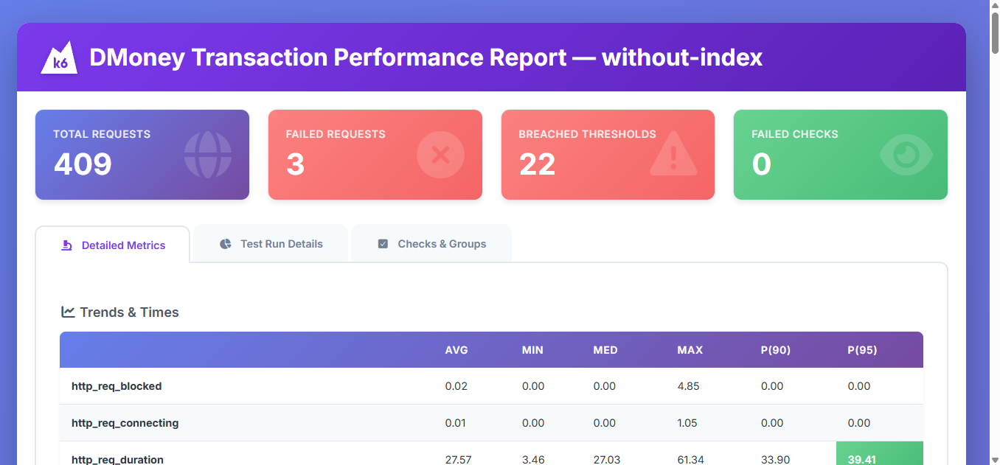
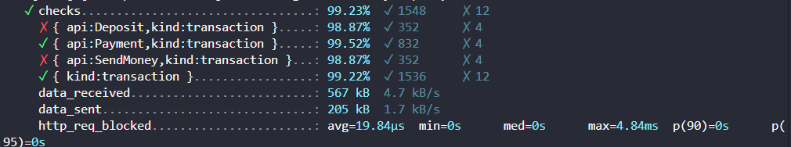
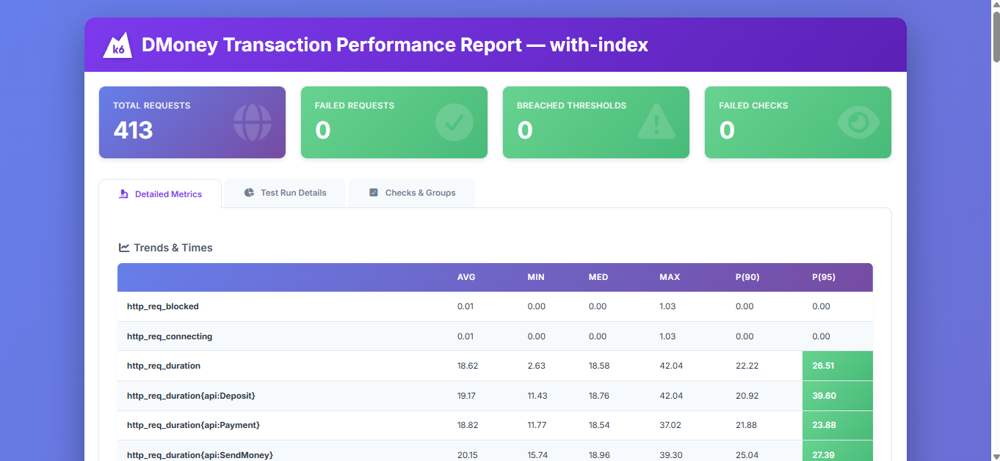
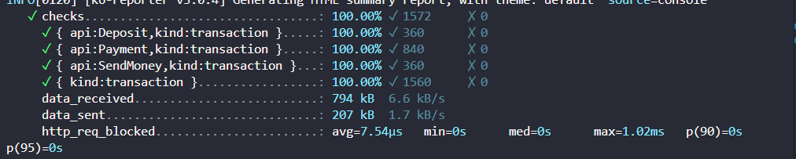

# DMoney Transaction Performance Test

A two-minute, scenario-based k6 test for Deposit, Send Money and Payment APIs. Six dedicated accounts authenticate with their own credentials: two Agents, two Customers and two Merchants. Each transaction uses its sender's token.

## Workload

| Time | Concurrent transactions |
| --- | --- |
| 0-30s | Customer 1 sends to Customer 2; Customer 2 pays Merchant 1 |
| 30-60s | Customer 2 sends to Customer 1; Agent 1 deposits to Customer 2; Customer 1 pays Merchant 1 |
| 60-90s | Agent 1 deposits to Customer 1; Agent 2 deposits to Customer 2; Customer 1 sends to Customer 2; Customer 2 pays Merchant 2 |
| 90-120s | Agent 1 and Customer 1 pay Merchant 1; Agent 2 and Customer 2 pay Merchant 2 |

Thirteen `constant-vus` scenarios use one VU per activity, a one-second post-response sleep and `gracefulStop: '0s'`. Login/preflight and reporting are outside the 120-second workload. Each transaction amount is 10, plus applicable sender fees.

## Setup

Requires Node.js 22+, k6 (tested with 2.2.0), and the local DMoney backend/MySQL with `mysql2` installed. No additional npm dependencies are needed. Allow k6 access to `jslib.k6.io` and `raw.githubusercontent.com` for reporting.

For first-time configuration only:

```powershell
if (!(Test-Path .env)) { Copy-Item .env.example .env }
```

Set `LOCAL_BACKEND_ENV_FILE` to your backend's `.env` path and enter its Admin/System credentials. Leave `PARTNER_KEY`, `DEFAULT_OTP` and `TEST_MAILBOX` blank to inherit backend settings. DB helpers support local `dmoneydb` only.

Credentials and local backups are Git-ignored; do not publish them. Keep `DAILY_*` / `MONTHLY_*` at normal quota values; the runner supplies temporary values automatically.

## Run

Use PowerShell from the project folder. Keep the API/MySQL running, stop all other UI/API/jobs traffic and run each command separately.

### 1. Without account index

```powershell
npm run index:check
```

Proceed when `Account-leading indexes: none` appears. Otherwise, use `npm run index:drop` only for this helper's index and check again. Existing application indexes must not be dropped for this experiment.

```powershell
npm run seed
npm run perf:without-index
```

Seed reuses the saved six accounts and tops up balances; it does not reset history/quotas.

### 2. With account index

After the first run finishes and original limit restoration is verified:

```powershell
npm run index:add
npm run seed
npm run perf:with-index
```

The helper adds `idx_transactions_account_k6` on `Transactions(account)` if needed. Both tests use identical workloads and verify index state before/after execution.

For both tests, type `RAISE CUSTOMER LIMITS` and press Enter. Daily/monthly limits temporarily increase to at least 10,000 transactions and 1,000,000 amount, affecting **all Customers**. They remain active; originals are backed up and restored afterward.

Confirm `Original Customer limit settings restored and verified`. If restoration fails or execution is force-killed, stop test traffic and run:

```powershell
npm run restore-db
```

Restoration does not undo transfers, fees, balances or quota usage. The index remains; optional `npm run index:drop` removes only the helper-created index. Keep its local ownership record.

## Validation

Checks validate HTTP 201, success/no-error with valid balance, nonempty `trnxId`, and the exact success message. Global and per-API thresholds require:

- HTTP failure rate **<1%**
- p95 response time **<1000ms**
- Transaction checks **>=99%**

Phase/coverage thresholds also detect incomplete runs. Threshold failures can still generate reports; setup failure with zero transactions is not a pass.

## Recorded results

Both selected runs verified index state and restored limits. Transaction metrics exclude setup. Req/s uses active API seconds: Deposit 60s, Send Money 90s, Payment 120s.

| Run | API | Avg ms | p95 ms | Req/s | HTTP fail % | Checks pass % |
| --- | --- | ---: | ---: | ---: | ---: | ---: |
| Without index | Deposit | 30.44 | 42.60 | 1.48 | 1.12 | 98.88 |
| Without index | Send Money | 29.80 | 37.34 | 0.99 | 1.12 | 98.88 |
| Without index | Payment | 27.40 | 38.51 | 1.74 | 0.48 | 99.52 |
| With index | Deposit | 19.17 | 39.60 | 1.50 | 0.00 | 100.00 |
| With index | Send Money | 20.15 | 27.39 | 1.00 | 0.00 | 100.00 |
| With index | Payment | 18.82 | 23.88 | 1.75 | 0.00 | 100.00 |

**Without index: FAIL** — 387 transactions, 3 failures; 89/111 thresholds passed. All failures occurred in 60-90s (2.56% failure rate); phase p95 rose from 33.10ms in 0-30s to 44.62ms. Deposit and Send Money breached API reliability thresholds.

**With index: PASS** — 390 transactions, zero failures, 100% checks; 111/111 thresholds passed. Phase 60-90s p95 was 28.00ms. Deposit p95 still rose from 32.26ms to 39.18ms as its concurrency doubled.

One local run pair does not prove an index eliminates deadlocks. Starting ledger sizes differed (5,070 vs 7,214 rows); controlled comparisons require matching DB snapshots.

### Without index evidence

[HTML report](reports/without-index-2026-10-12T17-47-19-485Z/report.html) · [API/phase results](reports/without-index-2026-10-12T17-47-19-485Z/results.md)

HTML overview:



Terminal metrics (check summary):



### With index evidence

[HTML report](reports/with-index-2026-10-12T18-05-34-429Z/report.html) · [API/phase results](reports/with-index-2026-10-12T18-05-34-429Z/results.md)

HTML overview:



Terminal metrics (check summary):



## Report files

Each run prints a timestamped report folder. Open `report.html` locally; GitHub displays HTML source. Overview HTTP totals include setup (409 without index, 413 with index), unlike the transaction totals above.

`comparison.html` / `results.md`: API/phase analysis. `summary.json`: raw metrics. `run-metadata.json`: index verification and limit restoration.
